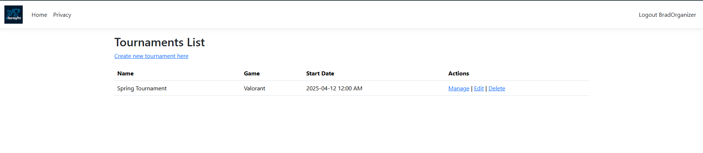
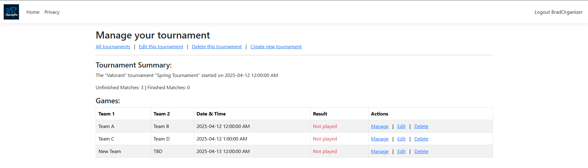
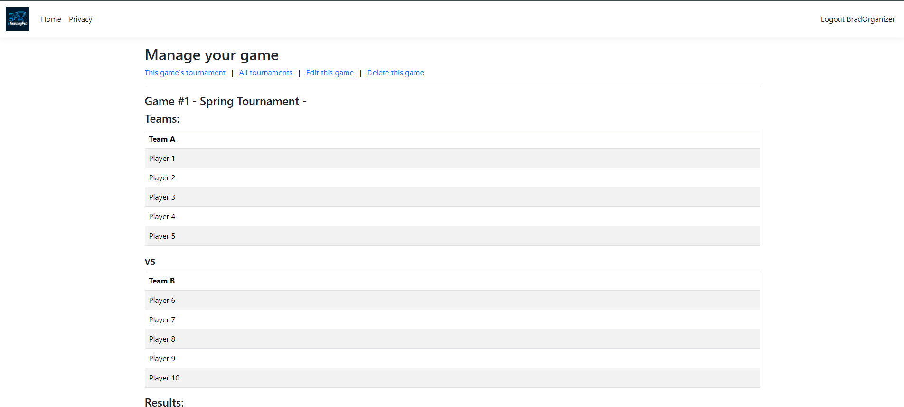

# eTourney Pro

**Tournament organization and player registration platform** built as a collaborative enterprise application development project.

eTourney Pro is an ASP.NET Core MVC application for organizing video-game tournaments. Organizers can manage tournaments, schedule games, work with teams and players, and review registrations. Participants can browse tournaments and register through the web interface or the companion REST API. The repository also includes a Python command-line API client and an email notification service.

**Technology:** C# · ASP.NET Core MVC (.NET 9) · Razor Views · Entity Framework Core · Microsoft SQL Server · ASP.NET Core Identity · Hangfire · REST/JSON · Python Requests · Bootstrap · Docker

> **Project status:** Coursework portfolio project. The source implements the workflows described below, but this README is based on source inspection rather than a verified end-to-end deployment. A SQL Server instance and environment-specific configuration are required. Some features, particularly registration email and reminders, require additional setup and testing.

## Application screenshots

These screenshots show the application running locally with seeded demonstration data. They illustrate the current ASP.NET Core MVC interface rather than a hosted production deployment.

### Tournament listing



### Tournament management



### Game management



## Features

- **Tournament management:** browse tournaments; organizer-only creation, editing and deletion; configure game title, team size, date/time and number of games.
- **Game and team management:** create and edit scheduled games, teams, scores and player assignments; view game details and winning-team calculations.
- **Player registration:** register for tournaments with a name and email address, stored through Entity Framework Core.
- **Organizer authorization:** ASP.NET Core Identity authentication and `Organizer` role protection on administrative actions.
- **Tournament REST API:** discover links, list tournaments, list a tournament's games, register a participant and retrieve an individual game.
- **Python API client:** interactive command-line client for querying tournaments/games and submitting registrations.
- **Notification infrastructure:** SMTP registration messages and Hangfire-based delayed notification methods. The delayed-email method exists in the service; an end-to-end background reminder flow has not been verified.

## Architecture

```text
Browser / Razor views                Python CLI client
         |                                    |
         v                                    v
ASP.NET Core MVC controllers          Tournament REST API
         |                                    |
         +----------------+-------------------+
                          |
                  Application services
                          |
             Entity Framework Core / Identity
                          |
                    SQL Server DB

Notification service -> SMTP
Hangfire scheduler   -> separate SQL Server storage
```

The web application uses MVC controllers and Razor views, with separate tournament/game entities, DTOs for API responses, and an Entity Framework Core database context. The repository includes EF Core migrations and a Dockerfile for the web application.

## API overview

Base path: `/tournaments-api`

| Method | Endpoint | Purpose |
| --- | --- | --- |
| GET | `/tournaments-api` | Discover API links and version metadata |
| GET | `/tournaments-api/tournaments` | List tournaments |
| GET | `/tournaments-api/tournaments/{tournamentId}/games` | List games and team names for one tournament |
| GET | `/tournaments-api/games/{gameId}` | Retrieve game details |
| POST | `/tournaments-api/tournaments/{tournamentId}/register` | Register a participant |

Example registration payload:

```json
{
  "name": "Sample Player",
  "email": "player@example.com"
}
```

**Note:** Registration triggers an SMTP send in the current implementation. Configure valid, newly issued credentials before exercising this endpoint; a missing SMTP configuration causes an error. The example above is illustrative, not a captured successful API response.

## Running locally (Windows)

### Prerequisites

- .NET 9 SDK
- Microsoft SQL Server (or a compatible SQL Server deployment)
- Git
- Python 3 and `requests` if using the optional CLI client

The repository's SQL Server connection strings default to local instances named `ETourneyProDB` and `HangfireDB`. Change them through configuration if your local setup differs. The project contains Entity Framework Core migrations for the main application database.

1. Clone the repository:

   ```powershell
   git clone https://github.com/ToastyKrawch/Group8_Enterprise_FinalProject.git
   cd Group8_Enterprise_FinalProject/Group8_Enterprise_FinalProject
   ```

2. Configure the SQL Server connection strings and optional development credentials. Follow **[SECURITY_SETUP.md](SECURITY_SETUP.md)** for the exact user-secrets commands. Do not reuse the previously exposed credentials.

3. Restore project dependencies and apply the existing EF Core migrations to your configured main database:

   ```powershell
   dotnet restore
   dotnet tool install --global dotnet-ef
   dotnet ef database update
   ```

   The migration step requires a reachable SQL Server instance and correctly configured credentials. Hangfire uses a separate SQL Server connection and may need its database created/provisioned.

4. Run the application with the existing HTTPS launch profile:

   ```powershell
   dotnet run --launch-profile https
   ```

5. Open **https://localhost:5001/Tournaments** in a browser.

   The development organizer account is **not automatically provisioned with a shared password**. To create one on startup in Development, supply `SeedOrganizer:Username` and `SeedOrganizer:Password` as explained in [SECURITY_SETUP.md](SECURITY_SETUP.md). The server does not create a default organizer account in non-development environments.

### Python API client

From the repository root:

```powershell
python -m pip install requests
python Group8_Enterprise_FinalProject/PythonClient/tournament_api_client.py
```

The Python client defaults to `https://localhost:5001/tournaments-api`; override this with `ETOURNEY_API_URL` as necessary. It validates HTTPS certificates, so a locally issued development certificate may need to be trusted or configured through `REQUESTS_CA_BUNDLE`. Details: [SECURITY_SETUP.md](SECURITY_SETUP.md).

## Source layout

```text
Group8_Enterprise_FinalProject.sln
Group8_Enterprise_FinalProject/
  Controllers/           MVC routes for accounts, games and tournaments
  API's/                REST API controller
  Entities/             Database models, context and seed data
  Migrations/           EF Core database migrations
  Services/             Tournament and notification services
  Models/               MVC view models
  Messages/             API DTOs and link models
  Views/                Razor pages
  PythonClient/         Interactive Python REST client
  wwwroot/              Static assets and application logo
  Dockerfile            Multi-stage .NET build
SECURITY_SETUP.md       Secret management and rotation guidance
```

## Technical notes and limitations

- SMTP email is sent synchronously on registration and depends on a working external mail account. Treat this as a development demonstration, not a production-ready notification workflow.
- Hangfire is configured with SQL Server storage and a scheduling method is implemented; do not assume background reminders execute without testing the full flow.
- The source currently permits a broad CORS policy for the tournament API; it should be restricted before any production deployment.
- Docker configuration is present, but container startup with SQL Server has not been verified.
- The project includes migration files and sample development records; do not treat the sample data as a production dataset.
- Screenshots and an automated build/test workflow have not yet been added.
- The repository previously contained hardcoded credentials. They have been removed from active source, but may remain in Git history. See [SECURITY_SETUP.md](SECURITY_SETUP.md) for required credential rotation.

## Team and project scope

Developed as a **Group 8 enterprise application development course project**. This repository contains collaborative work; no individual ownership claims are made for components without separate attribution records.

The project is presented as a software-development portfolio artifact, not as a deployed commercial tournament service.
